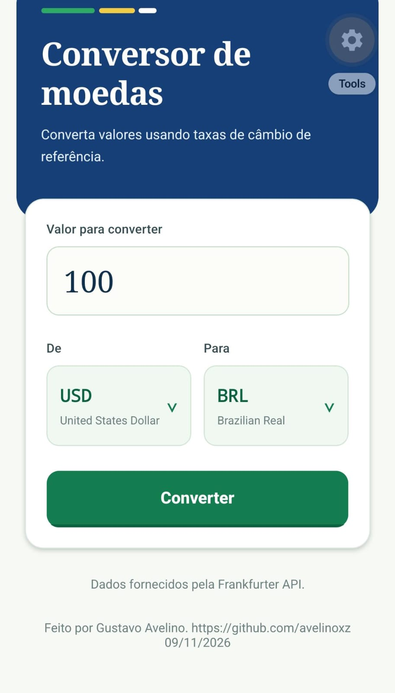
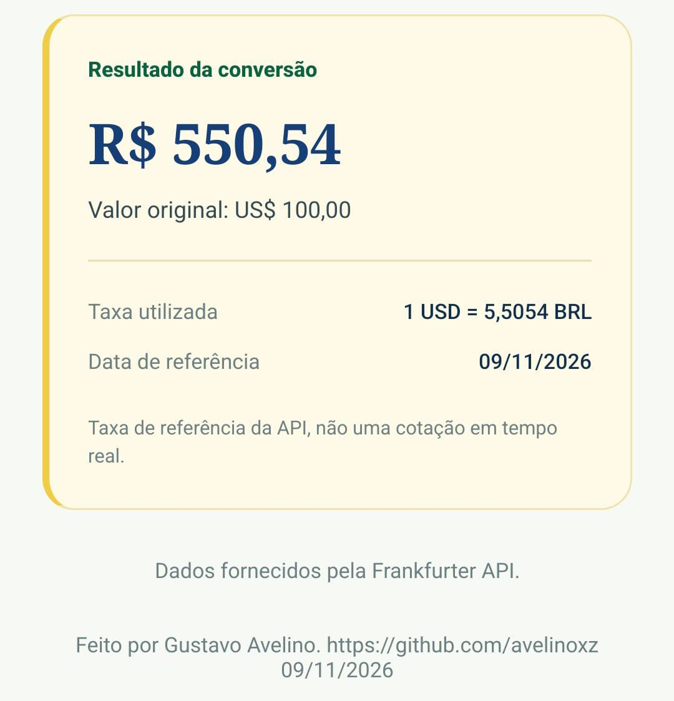
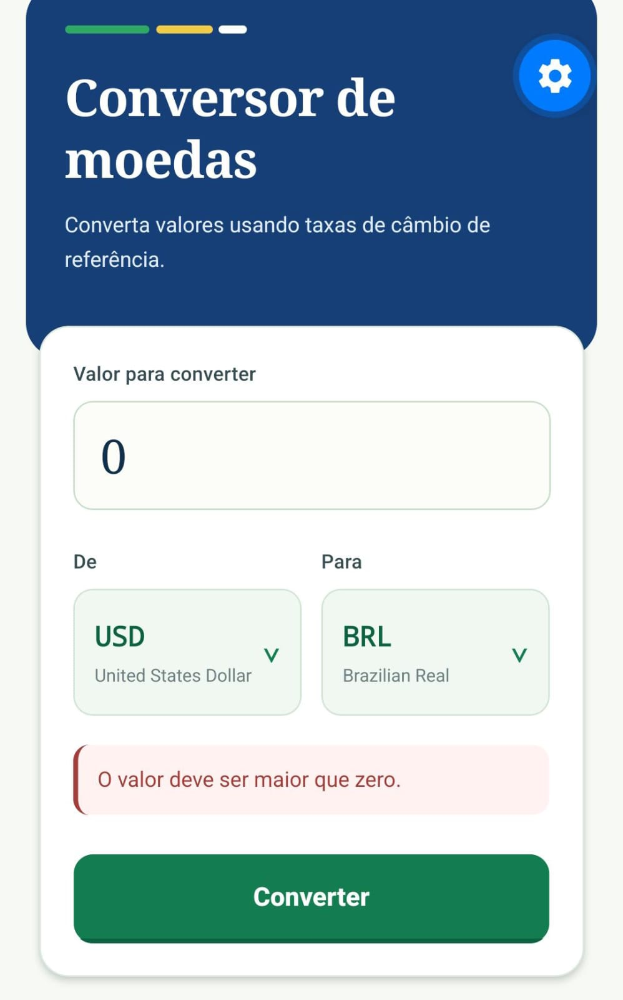
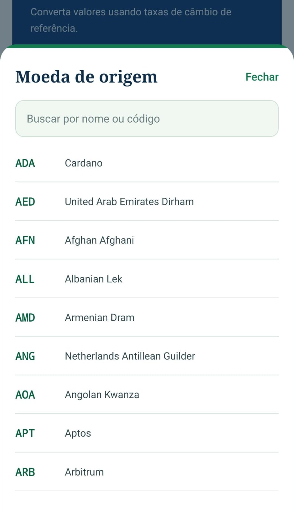

# Conversor de Moedas

Aplicativo mobile de conversão de moedas desenvolvido em **React Native + JavaScript (Expo)**, utilizando a arquitetura **MVVM (Model-View-ViewModel)**.

O aplicativo utiliza a API pública **Frankfurter** para consultar moedas disponíveis e taxas de câmbio, sem necessidade de chave de API.

## Tecnologias utilizadas

- React Native
- JavaScript
- Expo
- React Hooks
- API Frankfurter
- Arquitetura MVVM

## Requisitos

- Node.js compatível com a versão do Expo utilizada.
- npm instalado.
- Expo Go no celular ou emulador Android/iOS.
- Conexão com a internet.

## Como executar

Clone o repositório:

```bash
git clone https://github.com/avelinoxz/ConversorMoedas.git
```

Entre na pasta do projeto:

```bash
cd ConversorMoedas
```

Instale as dependências:

```bash
npm install
```

Inicie o aplicativo:

```bash
npx expo start
```

Depois, escaneie o QR Code utilizando o **Expo Go**.

Para executar no emulador Android, pressione `a` no terminal.

Caso tenha problemas de conexão, utilize:

```bash
npx expo start --tunnel
```

## Como usar

1. Digite um valor positivo, como `100`, `100,50` ou `100.50`.
2. Selecione a moeda de origem no campo **De**.
3. Selecione a moeda de destino no campo **Para**.
4. Pressione o botão **Converter**.
5. Visualize o valor convertido, a taxa utilizada e a data de referência.

**Observações:**

- O campo aceita até duas casas decimais.
- Não utilize separadores de milhar.
- As moedas de origem e destino devem ser diferentes.
- A conversão depende de uma conexão com a internet.

## Funcionalidades

- Conversão entre diferentes moedas.
- Consulta de taxas pela API Frankfurter.
- Listagem dinâmica de moedas disponíveis.
- Validação dos valores informados.
- Exibição da taxa de câmbio.
- Exibição da data de referência.
- Indicador de carregamento.
- Tratamento de erros de conexão.
- Formatação dos valores monetários.

## Arquitetura MVVM

O projeto utiliza a arquitetura MVVM, separando as responsabilidades em três camadas:

**Model:** responsável pela comunicação com a API Frankfurter e obtenção dos dados.

**View:** responsável pela interface visual e interação com o usuário.

**ViewModel:** responsável pelas validações, estados e lógica de conversão.

Essa organização facilita a manutenção e compreensão do código.

## Capturas de Tela

### 1. Tela inicial

Interface principal do aplicativo, com os campos de valor e seleção de moedas.



### 2. Conversão concluída

Resultado da conversão, apresentando o valor original, valor convertido, taxa de câmbio e data de referência.



### 3. Validação de dados

Mensagem exibida quando o usuário informa um valor inválido ou seleciona moedas iguais.



### 4. Seleção de moedas

Lista de moedas disponíveis para conversão, carregadas diretamente da API.



## Observações

A API Frankfurter fornece **taxas de referência**, e não cotações comerciais em tempo real.

O aplicativo necessita de conexão com a internet para consultar as moedas e realizar as conversões.

O projeto foi desenvolvido com foco na simplicidade, organização do código e aplicação da arquitetura MVVM.

## Repositório

GitHub: https://github.com/avelinoxz/ConversorMoedas
